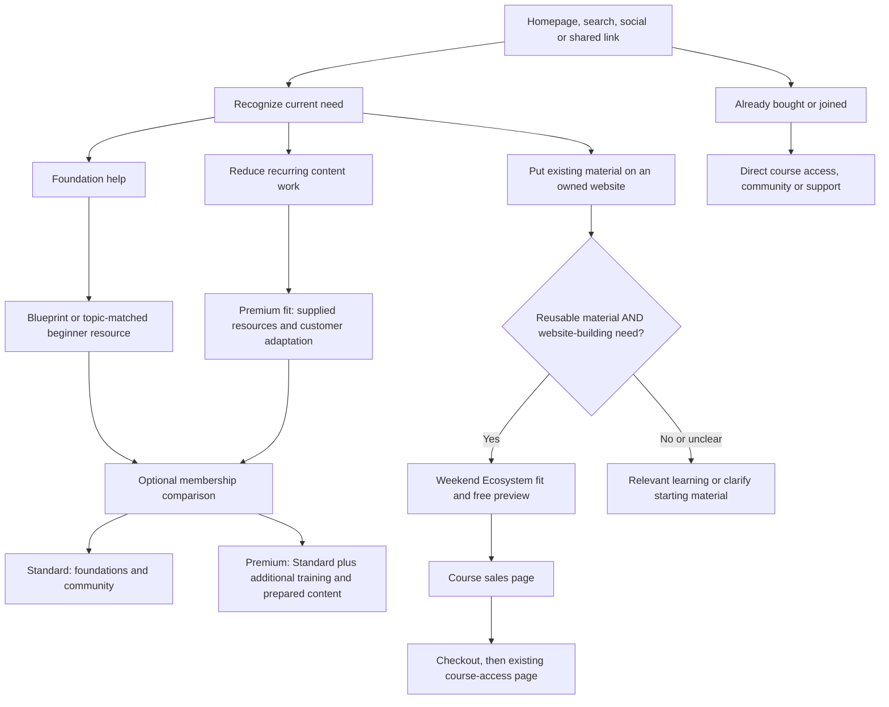

# TDIE website client journeys

Reviewed mapping specification, 16 October 2026. This phase defines journeys, qualification and page responsibilities. It does not change public copy, section order, aesthetics, application code, APIs, access controls or email automations.

## Purpose and settled decisions

The Digital Income Edit™ website helps each woman recognize what she needs now, whether an offer fits her and where to go next. The Built Backwards Method explains business-building order. It does not prescribe a sequence of TDIE purchases.

Show recognizable paths immediately. Find Your Door is optional help. Visitors may enter through any article, resource, product, search result, shared link or customer-access page without visiting the homepage.

Standard and Premium are choices about training, resources and workload. A beginner can choose either. Downloading a resource, owning one product or joining membership never establishes eligibility for The Weekend Ecosystem™.

## Journey map

Each path is independent. Arrows show a useful continuation, not a compulsory purchase.

The diagram shows the three core education journeys and returning-customer access. The matrix below maps the additional independent journeys. There is deliberately no Blueprint, single-product or membership arrow to the course. The Amazon-content path does not activate checkout or release. Lifestyle shoppers can shop without taking any education path.

## Qualification matrix

These are recommendation conditions, not new checkout restrictions or entitlement rules. A visitor may inspect public offer information without taking a quiz.

| Need or destination | Required fit | What is supplied | Customer work and boundaries | Next destination |
| --- | --- | --- | --- | --- |
| Foundation help | Wants to understand or build business foundations | Blueprint or relevant beginner learning | Use the resource to identify a useful first action. A download says nothing about course readiness. | Relevant resource; optional membership comparison |
| Standard | Wants foundations, training and community | Standard training, community and included resources | Learn and implement; create and adapt her own business materials. Value Vault guides are purchased separately. | Membership comparison, then current Skool plans |
| Premium | Wants added training, guide access or less recurring content preparation | Everything in Standard, additional training, Premium Vault and Premium DFY Content Calendar | Beginners can use foundations, additional training and unlocked guides immediately. Promotional calendar slots need an offer to adapt to, or the separately permitted TDIE affiliate route. Adapt details, generate visuals and publish. It is not a universal finished blog-writing service. | Membership comparison, then current Skool plans |
| The Weekend Ecosystem™ | Existing reusable material AND a relevant desire to build an owned website | Guided website and blog build using existing material | Inventory and select material, follow the build, review output and connect the site. No paid offer, Skool ownership or technical experience prerequisite. No invented minimum years, quantity or earnings threshold. No existing material means do not recommend the course. | Free preview and fit explanation, sales page, current checkout, course access |
| Pretty & Paid PLR Vault™ | Wants finished digital products to customize and sell | Licensed products, customization/shop training and stated supporting resources | Select, customize, follow license terms, list and market. No existing shop or membership prerequisite. Shared PLR is not exclusive product creation. | Independent product page, existing sample or checkout |
| Physical products | Wants a physical-product business | Shopify Starter Kit and relevant Shopify education | Choose products and build a store. A store need alone does not establish course fit. | Starter Kit; optional membership training |
| WYS information | Already uses an eligible Amazon affiliate path and needs content-production help | Only describe capabilities supported by reconciled current sources | Confirm supported Associates/Influencer configuration, customer setup and requirements. Release remains held. Do not require an Influencer storefront for every supported path. | Conditional information only until release conflict is resolved |
| Lifestyle shopping | Wants the pictured products or look | Photographs, product shelf and relevant verified destinations | No business-readiness test, newsletter or training detour. Keep styling extras distinct from shoppable items. | Appropriate Amazon item or Idea List |
| Personal services | A problem matching an existing engagement | Engagement explanation before application | Scope and suitability are assessed through the current application process; no invented deliverables or prices. | Relevant Work With Me application |
| BAMI | Wants to understand BAMI | Existing programme information and waitlist | No open-enrolment, cohort-date or price claim. It is separate from membership. Preserve its own format and terms. | Current waitlist |
| Topic learning | Wants a specific answer | Article, related learning and topic-matched free help | Topic interest alone is not product readiness. Reading remains available without subscribing. | Next lesson/resource; qualified paid option only if relevant |
| Returning customer | Already purchased or joined | Existing access and support routes | Use existing authentication. Do not sell access again or bypass entitlement checks. | Course, Skool community/classroom or support |

### Vault and content distinctions

- The Value Vault is the open guide storefront. Standard does not include every guide. Do not turn it into a locked course or newly promote the flagged Vault Unlock offer.
- The Premium Vault contains the same guides already unlocked through Premium.
- Pretty & Paid PLR Vault™ is a separate subscription, included in neither membership tier.
- Daily Prompts, Daily Edits of the Past and the Premium DFY Content Calendar retain their separate roles. Daily Prompts is never described as a calendar.

### Recommendation order

1. Identify the actual need. Returning-customer access and Lifestyle shopping have direct paths.
2. Check relevant prerequisites. For the course, confirm reusable material and an owned-site need separately. An offer, shop, audience, community account or email list is not itself evidence of reusable material.
3. Treat unknown or contradictory answers as a request to clarify. Never convert unknown into course eligibility. If material is absent, offer relevant foundation learning. If material is unclear, help the visitor identify it without assuming she is a beginner.
4. Rank only suitable paths by the stated need and preferences. Payment preference, automation interest and available time cannot override missing prerequisites.
5. Explain why the recommendation fits, what is supplied, what the customer still does and who should skip it. Show another suitable option if appropriate, without predicting a later purchase.

`journey-rules.json` records these decisions for later implementation. It is a specification, not imported by the website. Existing public payloads and APIs remain unchanged in this phase.

## Page responsibilities

| Surface and current route | Must accomplish | Appropriate continuation | Current behavior requiring attention |
| --- | --- | --- | --- |
| Homepage `/` | Explain TDIE broadly and show visible choices by current need. Explain unfamiliar offers in their own context. | Relevant route immediately; optional Find Your Door | Public browser confirms Blueprint followed immediately by Friday/Sunday. Hero also connects one product to a website and a course link without qualification. Nest course-specific transformation in an explicitly qualified course introduction. |
| Shared navigation `src/data/site.js` and homepage navigation | Make learning, shopping, offers and customer access discoverable | Direct routes; access and support reachable from any entrance | Current Start Here points to the quiz; footer has support but no direct course-access/customer grouping. Keep quiz optional and reuse existing access destinations. |
| Find Your Door `/resources/find-your-door` | Eligibility before preference ranking; on-screen reason and skip condition; no forced signup | Suitable resource or offer information | Weighted scores currently choose among all doors. Time/payment/automation preferences can raise course score without material. Premium says skip without an offer. Result `later` text assumes future course purchases. Correct all result and static door variants together later. |
| Resource hub `/resources` | Visible situations and direct free choices before optional help | Specific resource or preview | Source describes quiz as strongest navigation. Existing content/no-system choice needs explicit website-need qualification for the course preview. Preserve direct kit access. |
| Library `/learn` and articles `/learn/<slug>` | Answer the search question; keep reading available; choose a relevant free continuation | Next article, topic resource or qualified offer | Shared ArticleLayout uses pillar defaults and per-article overrides. Business Systems and Blogging default to the course. Generic Blueprint band, captures and membership sidebar can compete with topic routing. Audit actual defaults AND overrides, not comments alone. |
| Blueprint `/resources/faceless-income-blueprint` | Deliver promised resource, explain its first use and one relevant next action | Foundation learning or optional support comparison | BlueprintForm supplies an inline download on API success. Page currently offers quiz, article and membership continuations. Specify one primary next action; never treat success as course eligibility. |
| Other free-resource pages `/resources/<slug>` | Deliver the named resource and explain its use | One topic-matched next step; continued learning available | BlueprintForm is reused with different kits, while some pages use other forms. Review each success state and surrounding recommendations rather than changing only the Blueprint page. |
| Shopify Starter Kit `/resources/shopify-starter-kit` | Keep physical-product store path coherent | Relevant Shopify learning or membership support | Three direct downloads plus email-gated Niche Vault and inline confirmation exist. Preserve delivery and store focus; consolidate competing next actions later. |
| Course preview `/weekend-ecosystem/preview` | Explain what the course builds from and show the actual learning format | Course fit/sales page when suitable; relevant learning when unsuitable | Public preview exists without email. A preview visit itself is not qualification. |
| Course sales `/shop/weekend-ecosystem` | Fit, starting material, supplied build, customer work, evidence and purchase/access process | Current checkout or preview; direct access for buyers | Existing-content exclusion and no-paid-product FAQ support this map. Preserve those distinctions across all referring pages. A course build timeframe must not become a promised business result. |
| Membership `/membership` | Let beginners and experienced visitors compare level of help; distinguish immediate resources from offer-dependent adaptation | Current Skool plans; existing community for members | Current page distinguishes training and content but needs explicit beginner-Premium explanation consistent with quiz. Membership does not include the standalone course or PLR. |
| PLR `/shop/pretty-and-paid-plr-vault` | Explain licensed product stock, customization, rights, supplied support and purchase | Current sample or checkout | Page already includes shop-opening support. Quiz framing assumes an existing shop. Do not force PLR through membership or into a course upsell. |
| WYS `/shop/while-you-sleep-storefront` and referring promotions | Explain fit/requirements only within release authority | Conditional information | Production page and time-dependent components show presale/launch/checkout states while main master holds release. No new activation or promotion is authorized by this map. |
| Lifestyle `/lifestyle`, category and look pages | Let shoppers recognize and buy the look directly | Visible horizontal product shelf, then relevant verified Amazon links | Shared Article component supplies photo gallery and horizontal shelf, but also has a shopping jump action before photos. Preserve all products and verify the required introduction → photos → shelf → article sequence in later implementation. Business education stays separately optional. |
| Work With Me `/work-with-me` | Explain named engagement, scope and process before application | Matching existing application email | Existing services and email process are available. A self-build alternative still requires course qualification. Do not transfer BAMI's personal-review format to these engagements. |
| BAMI `/bami` | Explain current programme and distinguish waitlist from enrolment | Existing waitlist | Waitlist exists; dates and founding price are not public commitments. Preserve current specific completion-reward terms without converting them into a generic membership/course ladder. |
| Customer access `/weekend-ecosystem/`, current Skool community/classroom, `/faq`, support email | Direct access, access-error help and billing/support | Existing authenticated route or support | Course email gate and support route exist. No purchase was made and no buyer entitlement or delivery was tested. Improve discoverability later without changing access controls. |
| Email follow-up | Deliver the promise and continue the visitor's actual need with the same qualification rules | One relevant continuation, buyer exclusions where applicable | Actual active sequences remain unverified. Repository email setup is not evidence of what runs. See email boundary below. |

## Article continuation rules

Retain each article's useful answer and its relevant free resource. For physical products, retain Shopify help; for digital product-stock needs, explain PLR independently. Foundation articles may introduce membership as optional support. Business Systems, Blogging and course-specific articles may mention the course only with its material-plus-website qualification beside the recommendation. A category match never establishes the reader's assets.

Check per-article `routeFree` and `routePaid` overrides as well as shared defaults. Existing overrides occur in `creating-your-first-offer`, `email-marketing-guide`, `how-to-build-a-faceless-digital-business` and `where-your-freebie-lives`. Review their final rendered recommendations in the later implementation phase.

Free journey slots remain genuinely free; owned paid slots do not become affiliate slots. Affiliate recommendations stay separate and carry required disclosure and link attributes. Keep the owned-domain Pinterest destination block in scope for Pinterest links; an on-site Lifestyle shopping path does not remove it.

## Delivery and email boundary

The intended continuation is distinct from current service behavior:

| Entry | Intended continuation | What is currently established |
| --- | --- | --- |
| Blueprint or topic kit | Deliver resource, explain first use, offer one relevant learning/support step | Form code renders an inline download after success. No submission or inbox delivery tested in this review. |
| Quiz | Show result without email; optional subscription; carry only valid fit information | Source has result rendering and signup metadata. `docs/find-your-door-email-setup.md` is setup guidance, including retired Vercel references, not an active-automation inventory. |
| Course purchase | Current checkout → buyer access and support; suppress inappropriate acquisition follow-up | Course email gate exists. Actual purchase, webhook processing, MailerLite buyer entry and inbox delivery unverified. |
| Existing member/buyer | Relevant access/help and suitable learning | No entitlement changes; actual customer account state not inspected. |

Before changing email, inspect active MailerLite triggers, groups, messages, links, buyer exclusions, timing and plan capacity through the permitted MailerLite plugin. No callable MailerLite connection was available in this session. Do not use a browser, historical counts or other email tools as a substitute. Email qualification and delivery are not implemented or verified by these documents.

## Evidence and source conflicts

Production source baseline: `cloudflare-migration` commit `6406c49e5408814e3e036ebba0c1f1c74b98ac63`, refreshed 16 October 2026. Public homepage and course inspected in the browser on 16 October. A search-service homepage snapshot showed a different section order; the browser confirmed the Blueprint → Friday/Sunday order. The snapshot is not used as deployment evidence.

Current governing files read from `main` on 16 October:

- [canon.json](https://github.com/jodiedeo7-glitch/tdie/blob/main/ops/canon/canon.json), blob `152d63f597867fe1b88d97e5fb6b557efac28074`.
- [TDIE_CANON.md](https://github.com/jodiedeo7-glitch/tdie/blob/main/ops/canon/TDIE_CANON.md), blob `8bb592a41b4e4ad1abfee27b4047d349b73b2ab9`.
- [WYS master](https://github.com/jodiedeo7-glitch/tdie/blob/main/claude/WYS_REFERENCE_PACK_2026-10-07.md), blob `da5b16e1d327e23a28439edda55af2eb5dbe7250`.

Primary implementation evidence is at the production baseline in `src/pages/index.astro`, `src/pages/resources/find-your-door.astro`, `src/layouts/ArticleLayout.astro`, `src/components/BlueprintForm.astro`, `src/pages/resources/index.astro`, `src/pages/resources/shopify-starter-kit.astro`, `src/pages/shop/weekend-ecosystem.astro`, `src/pages/membership.astro`, `src/pages/shop/pretty-and-paid-plr-vault.astro`, `src/pages/work-with-me.astro`, `src/pages/bami.astro`, `src/pages/weekend-ecosystem/index.astro`, `src/components/lifestyle/Article.astro` and `src/data/site.js`.

Conflicts remain explicit:

1. **WYS release:** main master sections 14, 25 and 26 preserve a customer release HOLD. Production `src/pages/shop/while-you-sleep-storefront.astro`, `WysWhen` and homepage promotion advertise timed access or automation. Neither the clock nor the live promotion clears that hold. This map records a conditional path and does not settle release authority.
2. **Premium fit:** production quiz says skip Premium without an offer, while Jodie's approved journey decision allows beginners to choose Premium. Later routing and fit explanations must follow the approved decision and explain resource use accurately.
3. **Typography:** main governing brand references retain Newsreader/Inter; production AGENTS.md's explicit 10 October founder rules and deployed styles use Gloock/Jost with scoped Yellowtail. No typography is selected or governing file reconciled in this mapping phase.
4. **Historical ownership:** production AGENTS.md says Claude owns website work. Jodie's direct current request authorizes this mapping work; it does not grant WYS release or spending approval. Historical Claude instructions and attached handoff documents are reference evidence, not new user instructions.

The supplied handoff, mockups and screenshots inform later aesthetics. They do not determine offer eligibility or authorize a purchase ladder.

### Search Console snapshot

Whole-domain property `sc-domain:thedigitalincomeedit.com`, no filters. 16 September–13 October 2026: 4 clicks and 125 impressions. Comparison 19 August–15 September: 3 clicks and 106 impressions. This is the previously inspected fixed-date snapshot, not a claim of refreshed live totals.

Results include educational and Lifestyle pages. The sample supports multiple entrances. It does not establish visitor experience, conversions, customer readiness or a winning sales journey. Do not sum top-page rows into property totals or turn this small sample into an offer-priority claim.

## Acceptance and next implementation boundary

The eight requested scenarios and additional edge cases are reviewed in [review.md](review.md). The machine-readable specification is [journey-rules.json](journey-rules.json).

Mapping review checks the intended decisions and their coverage. It does not certify current production routing, purchases, affiliate destinations, authentication or MailerLite delivery. Those require later implementation and service-level checks.

The subsequent design and copy must express this map: visible choices, optional quiz, qualified course context, truthful membership comparison, independent PLR and shopping paths, direct customer access and the same eligibility rules wherever recommendations appear. Before starting that phase, review this map, matrix and page responsibilities together. No further aesthetic build belongs in this change.
